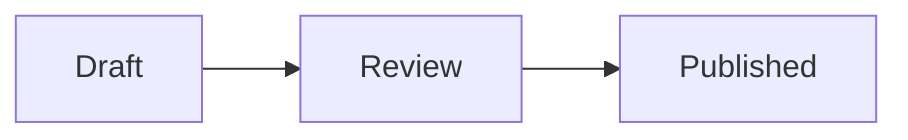

# Diagram examples

This copy-ready command writes an HTML example with one inline Mermaid bundle, one initializer,
and a diagram. Set `CLAUDE_PLUGIN_ROOT` to the installed plugin directory in a normal shell.
The pinned bundle and its MIT license live under `skills/artifact-server/assets/mermaid/`;
if that directory contains placeholders, follow its `VERSION` instructions first.

```bash
node --input-type=module <<'NODE'
import { readFileSync, writeFileSync } from 'node:fs'
import path from 'node:path'
const bundle = readFileSync(path.join(process.env.CLAUDE_PLUGIN_ROOT,
  'skills/artifact-server/assets/mermaid/mermaid.min.js'), 'utf8')
writeFileSync('diagram.html', `<!-- wt-artifact-server: interactive -->
<!doctype html><html><head><meta charset="utf-8"><title>Report diagram</title></head><body>
<pre class="mermaid">flowchart LR
  Draft --> Review --> Published
</pre>
<script>${bundle.replace(/<\/script/gi, '<\\/script')}</script>
<script>mermaid.initialize({ startOnLoad: true, theme: 'neutral', securityLevel: 'strict' });</script>
</body></html>`)
NODE
```

For Markdown, use an info string of exactly `mermaid`:

````markdown
# Report diagram

The review flow:


````
